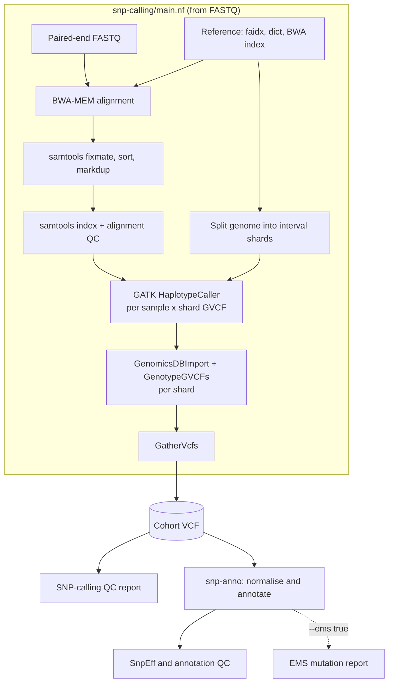

# Rapeseed WGS – EMS mutant analysis

Nextflow pipelines for whole-genome sequencing (WGS) analysis of **rapeseed (*Brassica napus*) EMS-mutagenized
lines**. The main goal is to call SNPs/small variants across a cohort of mutant lines, from which EMS-induced
mutations (mainly G/C→A/T transitions) can be identified and filtered downstream.

The code is portable to any HPC (Slurm, PBS, SGE, LSF) or a local machine; no cloud/infra code is included.

## Repository layout

```
nf_wgs_emsdb/
├── README.md                 # this file
├── Dockerfile                # shared local-test image for all pipelines
└── snp-calling/              # SNP/variant-calling pipeline (Nextflow DSL2)
   ├── main.nf               # FASTQ caller with scatter/gather and QC
   ├── nextflow.config
   ├── modules/
   └── README.md             # detailed usage, profiles, input layout
└── snp-anno/                 # portable SnpEff annotation and EMS reporting
   ├── main.nf
   ├── nextflow.config
   └── README.md
```

## Pipelines

| Script | Starts from | What it does |
|--------|-------------|--------------|
| [snp-calling/main.nf](snp-calling/main.nf) | Paired-end FASTQ | BWA-MEM, duplicate marking, alignment QC, scattered GATK calling/joint genotyping, gather and cohort QC. |
| [snp-anno/main.nf](snp-anno/main.nf) | Joint VCF, reference FASTA and GFF/GTF | Normalise/filter, build a reusable SnpEff database, annotate/extract effects, write QC and optional EMS reports. |

### Workflow



### Modules ([snp-calling/modules](snp-calling/modules))

- `reference/` – faidx, sequence dictionary and BWA index (cached in `--index_store`); interval sharding.
- `bwa/` – BWA-MEM alignment (streams directly to BAM).
- `samtools/markdup/`, `samtools/index/`, `samtools/qc/` – duplicate marking, BAM indexing, alignment QC.
- `gatk/scatter/` – per-shard HaplotypeCaller, per-shard joint genotyping, and VCF gathering.
- `qc_report/` – cohort SNP-calling QC report.
- Not wired into `main.nf`: `bowtie/` (alternative aligner), `multiqc/`, `gatk/haplotypecaller/`,
  `gatk/jointgenotyping/` (unscattered versions).

## Quick start

```bash
cd snp-calling
nextflow run main.nf -profile slurm,singularity \
   --reference /path/to/reference.fa --reads_fastq '/path/to/fastq/*_R{1,2}_*.fastq.gz' \
   --cohort_name family_trio

cd ../snp-anno
nextflow run main.nf -profile slurm,singularity \
   --genome_fasta /path/to/reference.fa --genome_gff /path/to/genes.gff3 \
   --genome_name bnapus --cohort_name family_trio \
   --snp_calling_results ../snp-calling/results
```

See [snp-calling/README.md](snp-calling/README.md) for the input layout, executor/container profiles, HPC module
usage and the local Docker test.

## Submitting jobs to an HPC cluster

Nextflow runs as a lightweight *head job* that itself submits every pipeline step to the scheduler, so only the
head job needs to be submitted (or run in `tmux`/`screen` on a login node for short tests).

1. **Get the code and Nextflow** on the cluster:
   ```bash
   git clone <repo-url> nf_wgs_emsdb && cd nf_wgs_emsdb/snp-calling
   module avail nextflow            # module names/versions differ per site
   module load nextflow java        # Nextflow needs Java 11+ (17 recommended)
   ```
2. **Put data on shared/scratch storage** using the layout in [snp-calling/README.md](snp-calling/README.md)
   (reference FASTA and paired FASTQs; pass them with `--reference` and `--reads_fastq`).
3. **Set site options** in the profile you use in [snp-calling/nextflow.config](snp-calling/nextflow.config)
   (e.g. `process.queue`, `process.clusterOptions = '--account=<project>'`), or pass a site config with `-c site.config`.
4. **Choose how tools are provided**: `-profile slurm,singularity` (containers) or `-profile slurm,nocontainer`
   after loading the tool modules (`bwa samtools gatk multiqc`) in the job script.
5. **Submit the head job** with a script like `run_nf.sbatch` (Slurm shown; for PBS/SGE/LSF swap the directives
   and use `-profile pbs|sge|lsf`):
   ```bash
   #!/bin/bash
   #SBATCH --job-name=nf-snp-calling
   #SBATCH --partition=<partition>
   #SBATCH --account=<project>
   #SBATCH --cpus-per-task=2
   #SBATCH --mem=8G
   #SBATCH --time=72:00:00
   #SBATCH --output=nf_head_%j.log

   module load nextflow java
   # module load bwa samtools gatk multiqc      # only for -profile ...,nocontainer

   export NXF_OPTS='-Xms512m -Xmx4g'
   export NXF_SINGULARITY_CACHEDIR=/scratch/$USER/singularity_cache   # only for singularity

   nextflow run main.nf \
       -profile slurm,singularity \
       --reference /scratch/$USER/nf_wgs_emsdb/data/ref/ref.fasta \
       --reads_fastq '/scratch/$USER/nf_wgs_emsdb/data/fastq/*_R{1,2}_*.fastq.gz' \
       --outdir    /scratch/$USER/nf_wgs_emsdb/results \
       -w          /scratch/$USER/nf_wgs_emsdb/work \
       -resume
   ```
   ```bash
   sbatch run_nf.sbatch
   ```
6. **Monitor and manage**:
   ```bash
   squeue -u $USER                  # head job + submitted task jobs
   tail -f nf_head_<jobid>.log      # pipeline progress
   nextflow log                     # run history; reports are in results/reports/
   scancel <jobid>                  # stop the head job (cancel its task jobs too if needed)
   ```
   Re-submit the same command with `-resume` to continue after a failure or a time-limit kill; completed steps
   are reused from the work directory.

Tips: keep `work/` on fast scratch (not home); request a head-job walltime longer than the whole run; lower or raise
per-process `cpus`/`memory`/`time` in the modules to fit your queue limits; delete `work/` once results are verified.

## Notes for EMS data

- Joint genotyping across all lines (and the wild-type/parent) lets you separate EMS-induced mutations from
  background variation; filtering (e.g. mutation-type, allele fraction, depth, shared-variant removal) is done
  downstream of the cohort VCF and is not part of these pipelines yet.
- *B. napus* is allotetraploid (AACC) with a large, repetitive genome; adjust memory/time in the modules and
  the intervals file to your reference.
