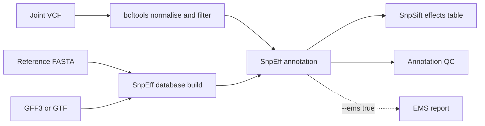

# SNP annotation and EMS reporting

Portable Nextflow DSL2 workflow for a joint-called VCF. It normalises and hard-filters variants with
bcftools, builds and reuses a custom SnpEff database from the matching FASTA plus GFF3/GTF, annotates the
VCF, extracts effects with SnpSift, and writes annotation QC. `--ems true` additionally creates read-based
EMS mutation reports from FORMAT/AD and DP.



## Run

Run `snp-calling/main.nf` first, or pass `--vcf` explicitly. Defaults are local paths under the repository
launch directory: caller results in `results/snp-calling`, annotation output in `results/snp-anno`, reusable
SnpEff databases in `results/snpeff_db`, and work files in `work/snp-anno`.

```bash
cd snp-anno
nextflow run main.nf -profile local,docker \
  --cohort_name family_trio \
  --genome_name brassica_napus \
  --genome_fasta /data/brassica.fa \
  --genome_gff /data/brassica.gff3
```

For Slurm with Apptainer:

```bash
nextflow run main.nf -profile slurm,apptainer \
  --vcf /scratch/results/snp-calling/cohort.joint.vcf.gz \
  --cohort_name cohort --genome_name brassica_napus \
  --genome_fasta /refs/brassica.fa --genome_gff /refs/brassica.gff3 \
  -w /scratch/work/snp-anno -resume
```

Executor profiles are `local`, `slurm`, `pbs`, `sge`, and `lsf`. Combine one with `docker`, `singularity`,
`apptainer`, or `nocontainer`. With `nocontainer`, provide Java, bcftools, bgzip/tabix, samtools, SnpEff,
SnpSift, and Python 3 in the environment; set `SNPEFF_HOME`, `SNPEFF_JAR`, and `SNPSIFT_JAR` when they are
not discoverable below a standard conda share directory.

For EMS analysis, add at least `--ems true --ems_wt_samples WT1,WT2`. Useful pool settings include
`--ems_pool_sizes pool1:4,pool2:4` and `--ems_families pool1:familyA,pool2:familyB`.

Outputs are grouped under `prepared/`, `annotation/`, `qc_report/`, `ems_report/`, and `reports/` beneath
`--outdir`. Delete the matching folder below `--snpeff_db_store` to rebuild a database after changing the
reference annotation.